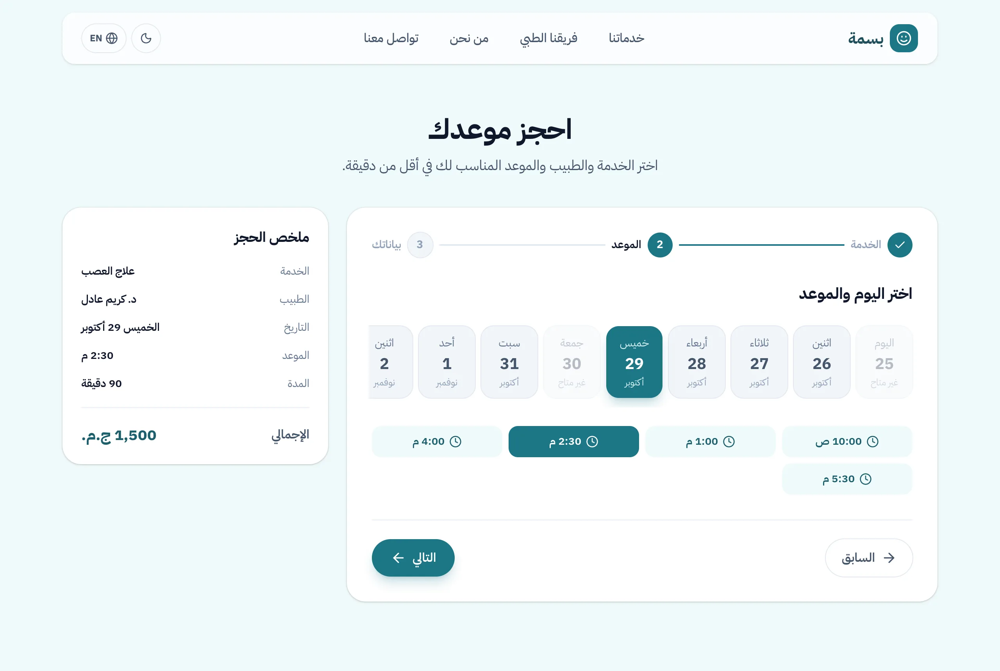
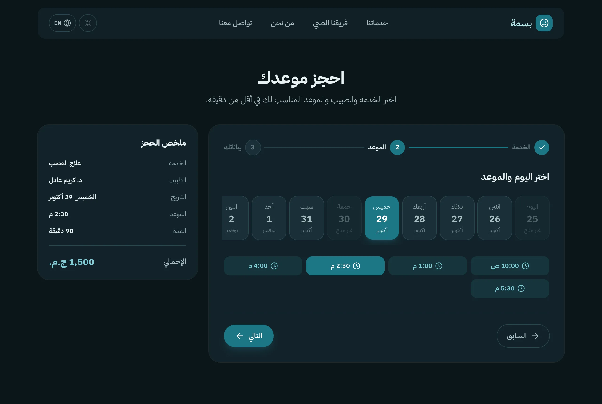
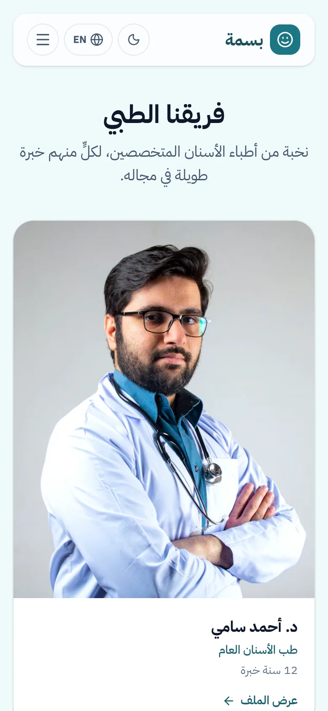

# Basma Dental

A dental clinic booking app in Arabic and English, built with React and TypeScript.

**Live demo:** https://basma-dental-mu.vercel.app



## Features

- 3-step booking: choose a service and doctor, pick a day and time, then enter your details
- Available times are calculated from working hours and existing bookings
- Arabic (RTL) and English
- Dark mode
- Services, doctors, about and contact pages

## Tech stack

React 19 · TypeScript · Tailwind CSS · React Router · TanStack Query · React Hook Form · Zod · i18next · MSW · Vitest

There is no real backend. API requests are handled by [MSW](https://mswjs.io) in the browser, and data is saved in `localStorage`.

## Notes

- All requests go through one API client, so switching to a real backend only needs a new base URL.
- Slot calculation is written as pure functions and covered by unit tests.
- If a time gets booked by someone else first, the API returns 409 and the user picks another time.
- Colors are theme tokens, so dark mode only changes the tokens in one CSS file, not every component.

## Screenshots

| Dark mode                                        | Mobile                                                                    |
| ------------------------------------------------ | ------------------------------------------------------------------------- |
|  |  |

## Run locally

```bash
npm install
npm run dev
```

Run tests with `npm test`.

## Credits

Photos from [Unsplash](https://unsplash.com) and [Pexels](https://www.pexels.com).
